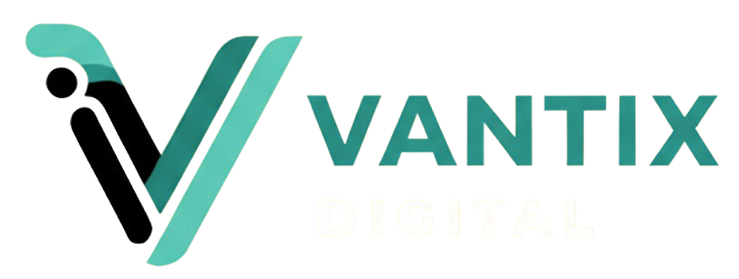
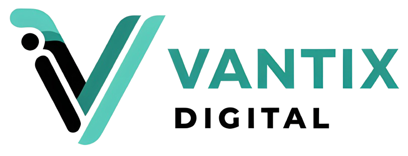
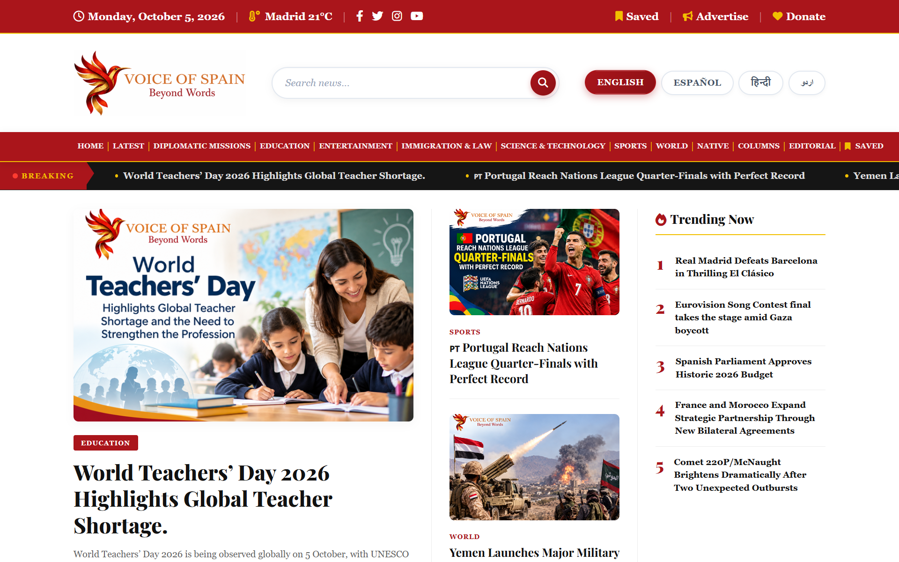
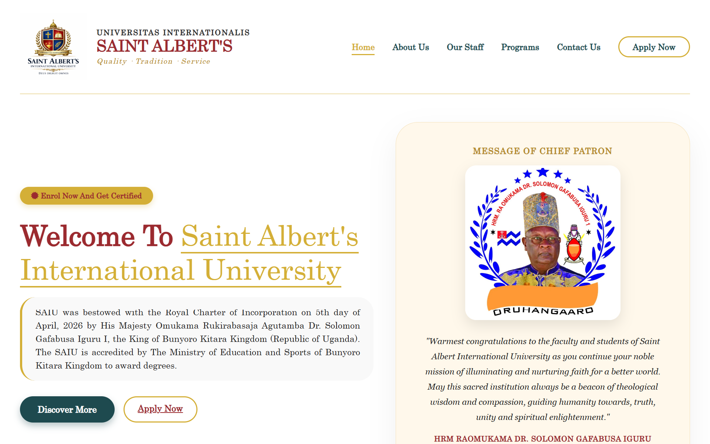
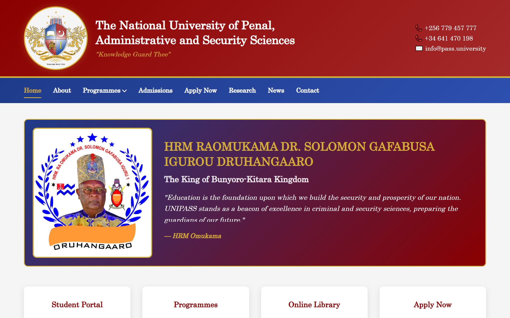
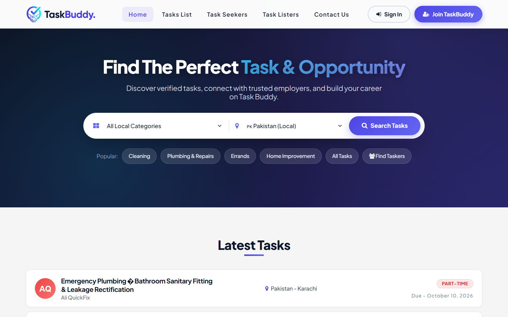
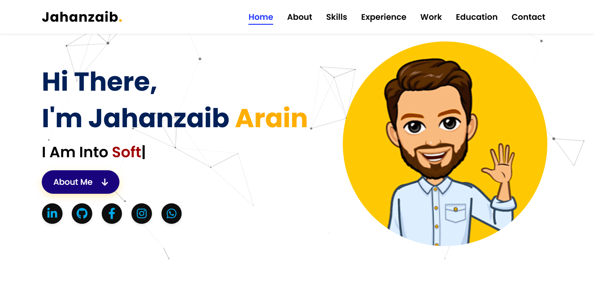
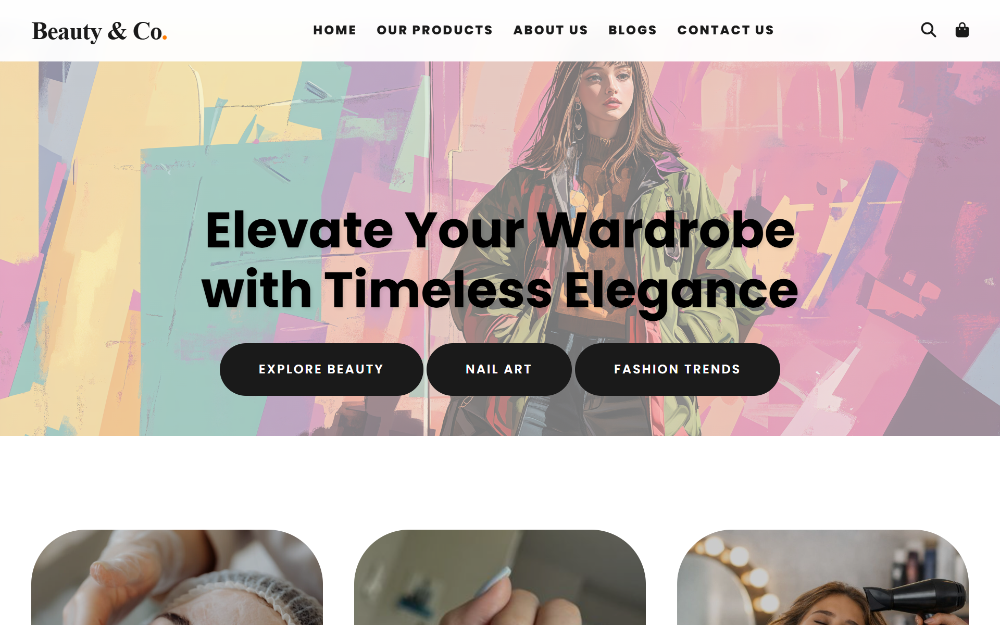

# 🚀 Vantix Digital — Smart Digital Solutions for Modern Brands

<div align="center">
  
  <h3>High-Performance Web Engineering, UI/UX Creative Design & Digital Growth Agency</h3>
  <p><i>"Turning Ideas into High-Performance, Scalable & Converting Digital Experiences"</i></p>

  <p align="center">
    <a href="https://vantix-digital.netlify.app/" target="_blank">
      
    </a>
    <a href="https://wa.me/447840179553" target="_blank">
      
    </a>
  </p>
</div>

---

<p align="center">
  
  
  
  
  
  
  
  
</p>

> **Vantix Digital** is an enterprise-grade, modern digital agency web application engineered with Next.js 16 (App Router), React 19, Tailwind CSS, and TypeScript. The platform delivers a high-converting digital presence featuring transparent Service Level Agreement (SLA) pricing tiers, dynamic WhatsApp lead capture funnels, interactive portfolio case studies, and thought leadership blogs designed for high search engine visibility.

---

## 🌐 Live Demonstration & Contact

The application is deployed and available for testing and client review:

- 🔗 **Production URL**: [https://vantix-digital.netlify.app/](https://vantix-digital.netlify.app/)
- 💬 **WhatsApp Direct Desk**: [+44 7840 179553](https://wa.me/447840179553)
- 📧 **Official Agency Email**: [hello.vantixdigital@gmail.com](mailto:hello.vantixdigital@gmail.com)
- 📍 **Headquarters**: 45 King Street, Manchester M2 7AY, United Kingdom

---

## 📑 Table of Contents
- [📖 Overview & Core Agency Philosophy](#-overview--core-agency-philosophy)
- [✨ Key Highlights & Features](#-key-highlights--features)
- [🏛️ Architectural Modules & Section Breakdown](#️-architectural-modules--section-breakdown)
  - [Module 1: Header Navigation & Sticky Glass Navbar](#module-1-header-navigation--sticky-glass-navbar)
  - [Module 2: Conversion Hero Section & Live Stats](#module-2-conversion-hero-section--live-stats)
  - [Module 3: Agency Story, 8+ Years Trust & Guarantees](#module-3-agency-story-8-years-trust--guarantees)
  - [Module 4: 6 Core Services with SLA Pricing Tiers](#module-4-6-core-services-with-sla-pricing-tiers)
  - [Module 5: 6 Value Features & Loyalty Benefits](#module-5-6-value-features--loyalty-benefits)
  - [Module 6: Live Production Portfolio & Case Study Modals](#module-6-live-production-portfolio--case-study-modals)
  - [Module 7: Industry Insights & Blog Modals](#module-7-industry-insights--blog-modals)
  - [Module 8: Dynamic Contact Desk & WhatsApp Funnel](#module-8-dynamic-contact-desk--whatsapp-funnel)
  - [Module 9: Footer & Global Brand Infrastructure](#module-9-footer--global-brand-infrastructure)
- [💼 Comprehensive SLA Services & Pricing Matrix](#-comprehensive-sla-services--pricing-matrix)
- [🌟 Live Client Portfolio Case Studies](#-live-client-portfolio-case-studies)
- [📸 Visual Interface & Portfolio Gallery](#-visual-interface--portfolio-gallery)
- [📱 Universal Multi-Device Responsiveness Matrix](#-universal-multi-device-responsiveness-matrix)
- [🛠️ Technology Stack](#️-technology-stack)
- [📂 Complete Project Directory Structure](#-complete-project-directory-structure)
- [🚀 Getting Started & Local Installation](#-getting-started--local-installation)
- [🎯 Performance, SEO & Security Hardening](#-performance-seo--security-hardening)
- [🤝 Contributing](#-contributing)
- [📝 License](#-license)
- [👤 Author & Agency Leadership](#-author--agency-leadership)

---

## 📖 Overview & Core Agency Philosophy

Building a modern online brand requires more than generic templates. It demands **bleeding-edge speed, mathematical UI/UX precision, and transparent execution timelines**.

### 🌟 Key Goals of the Platform:
- **Zero Friction Lead Generation**: Dynamic budget selectors linked directly to selected services with one-click WhatsApp dispatch.
- **Transparent Service Level Agreements (SLAs)**: Clear milestone deliverables, fixed turnaround times (3–30 business days), and a 7-day 100% money-back guarantee.
- **Detailed Portfolio Case Studies**: 6 live production client showcases equipped with 4–6 comprehensive paragraphs, architectural highlights, and live project visit links.
- **Code-First SEO Architecture**: Sub-second First Contentful Paint (FCP), semantic schema structure, and zero Cumulative Layout Shift (CLS).
- **Universal Multi-Device Adaptability**: Engineered from the ground up with a mobile-first philosophy tested across smartphones, tablets, laptops, and ultra-wide 4K screens.

---

## ✨ Key Highlights & Features

- ⚡ **Next.js 16 App Router Engine**: High-speed server rendering, dynamic routing, and instant layout hydration.
- 🎨 **Modern Agency Aesthetics**: Deep obsidian dark palette (`#090e17`), emerald glow accents (`#10b981`), glassmorphism, and kinetic micro-animations.
- 💬 **Dynamic WhatsApp Lead Capture**: Intelligent form routing that pre-fills client inquiries with service selection, budget tier, and custom message.
- 📊 **Interactive Service & SLA Modal**: Real-time modal detailing 3 distinct packages per service with scope deliverables and timelines.
- 🔍 **Interactive Portfolio Case Study Modal**: High-res banners, key architectural highlights, tech tags, and 4–6 detailed paragraphs.
- 🎁 **Client Guarantees & Perks**: Complimentary 1-Year Domain & Hostinger Server setup, 3-month free priority support, and 20% combo discount on UI/UX + Web Dev.
- ⚡ **1-Click Windows Launcher**: Double-click `Run-Website.bat` to auto-install dependencies, start the dev server, and open the browser.

---

## 🏛️ Architectural Modules & Section Breakdown

The application is engineered into **9 interconnected, modular components**:

| Module | Component | Description & Functionality |
| :--- | :--- | :--- |
| **01. Navbar** | [`Navbar.tsx`](src/components/Navbar.tsx) | Sticky glassmorphic header with active section spy, mobile drawer menu, and direct CTA. |
| **02. Hero** | [`Hero.tsx`](src/components/Hero.tsx) | High-impact headline, visual showcase banner, primary CTAs, and 8+ years experience badges. |
| **03. About** | [`About.tsx`](src/components/About.tsx) | Agency narrative, trust statistics, and 4 core SLA client guarantees with emerald checkmarks. |
| **04. Services** | [`Services.tsx`](src/components/Services.tsx) | 6 core services with starting prices, 3-tier SLA packages, and interactive workflow modal. |
| **05. Features** | [`Features.tsx`](src/components/Features.tsx) | 6 numbered value cards (Free Domain/Hosting, 3-Month Support, 20% Combo Discount, etc.). |
| **06. Portfolio** | [`Portfolio.tsx`](src/components/Portfolio.tsx) | Clean 6-card production showcase grid with 16:10 fixed canvas and full-screen case study modal. |
| **07. Blog** | [`Blog.tsx`](src/components/Blog.tsx) | 3 thought leadership articles with read-time badges, category tags, and full-screen article modal. |
| **08. Contact** | [`Contact.tsx`](src/components/Contact.tsx) | Interactive contact desk with dynamic budget selector automatically linked to active service. |
| **09. Footer** | [`Footer.tsx`](src/components/Footer.tsx) | UK headquarters info, newsletter subscription, quick navigation links, and social channels. |

---

## 💼 Comprehensive SLA Services & Pricing Matrix

All agency services are governed by standardized **Service Level Agreements (SLAs)**:

```
┌──────────────────────────────────────────────────────────────────────────────────┐
│                        VANTIX DIGITAL — SERVICE CATALOG                          │
├─────────────────────────┬──────────────────────┬─────────────┬───────────────────┤
│ Service Title           │ Starting Price       │ Timeline    │ Popular Package   │
├─────────────────────────┼──────────────────────┼─────────────┼───────────────────┤
│ 💻 Website Development  │ $200 - $1,200        │ 5 - 30 Days │ The Growth Hub    │
│ 🎨 UI/UX Design         │ $80 - $750           │ 3 - 10 Days │ The Professional  │
│ 📈 Code-First SEO       │ $150 - $900 / Month  │ 10 - 30 Days│ Business Authority│
│ 🌐 Guest Posting        │ $40 - $500+ / Post   │ 5 - 21 Days │ Authority Booster │
│ ✨ Brand Identity       │ $80 - $700           │ 3 - 20 Days │ Complete Identity │
│ 📊 Digital Marketing    │ $150 - $1,200 / Month│ 14 - 30 Days│ Growth Funnel     │
└─────────────────────────┴──────────────────────┴─────────────┴───────────────────┘
```

---

## 🌟 Live Client Portfolio Case Studies

Each project in the portfolio features comprehensive real-world documentation:

| # | Project Name | Domain / Niche | Live URL | Core Technologies |
| :-: | :--- | :--- | :--- | :--- |
| **01** | **Voice of Spain (VOS Media)** | Multilingual News Portal | [vos.media](https://www.vos.media/) | Next.js, Multilingual (EN/ES/HI/UR), High-Concurrency Caching |
| **02** | **Saint Albert's University** | Online Academic Campus | [saiu.education](https://saiu.education/) | Royal Charter, PHP 8, Session CAPTCHA, Privacy Logging |
| **03** | **University of Penal (UNIPASS)** | Security Sciences Portal | [pass.university](https://www.pass.university/) | 60+ Programmes, Google reCAPTCHA v2, INU Global Consortium |
| **04** | **TaskBuddy Web Portal** | Task & Gig Marketplace | [taskbuddy-portal](https://taskbuddy-portal.infinityfreeapp.com/) | 4 Modules, ATS Hiring Pipeline, Dynamic CV Builder, 785 QA Tests |
| **05** | **Personal Brand Portfolio** | Full-Stack Showcase | [jahanzaib-20](https://jahanzaib-20.netlify.app/) | Interactive UI, Netlify CDN, WhatsApp Conversion Funnel |
| **06** | **Beauty & Co. Storefront** | Luxury E-Commerce | [beauty-co](https://beauty-co.netlify.app/) | Dynamic Shopping Cart, Product Filtering, Fast Checkout |

---

## 📸 Visual Interface & Portfolio Gallery

<table width="100%">
  <tr>
    <td width="50%" align="center">
      <b>🚀 Vantix Digital — Agency Hero & Brand Header</b><br/>
      
    </td>
    <td width="50%" align="center">
      <b>🏆 About Vantix Digital & Core Guarantees</b><br/>
      
    </td>
  </tr>
  <tr>
    <td width="50%" align="center">
      <b>📰 Voice of Spain (VOS Media) — Multilingual News</b><br/>
      
    </td>
    <td width="50%" align="center">
      <b>🎓 Saint Albert's International University (SAIU)</b><br/>
      
    </td>
  </tr>
  <tr>
    <td width="50%" align="center">
      <b>🏛️ The National University of Penal (UNIPASS)</b><br/>
      
    </td>
    <td width="50%" align="center">
      <b>💼 TaskBuddy — Intelligent Gig & Task Marketplace</b><br/>
      
    </td>
  </tr>
  <tr>
    <td width="50%" align="center">
      <b>🌐 Personal Brand & Senior Developer Portfolio</b><br/>
      
    </td>
    <td width="50%" align="center">
      <b>🛍️ Beauty & Co. — Luxury Skincare & Fashion E-Commerce</b><br/>
      
    </td>
  </tr>
  <tr>
    <td width="50%" align="center">
      <b>📝 Insights — The Future of Web Design in 2026</b><br/>
      
    </td>
    <td width="50%" align="center">
      <b>📈 Growth — SEO Best Practices: Dominating 2026</b><br/>
      
    </td>
  </tr>
</table>

---

## 📱 Universal Multi-Device Responsiveness Matrix

Vantix Digital is built with a **mobile-first, adaptive responsive layout engine** tested across all viewports:

| Device Category | Screen Resolutions | Layout Adaptations | Status |
|---|---|---|:---:|
| 📱 **Compact Mobile** | `360px` – `390px` | Single-column cards, 55px safe-zone header, full-width touch buttons, modal stacking | ✅ **100% Tested** |
| 📱 **Standard Mobile** | `412px` – `480px` | Fluid grid, compact pill tags, bottom-friendly tap targets | ✅ **100% Tested** |
| 📟 **Tablet (Portrait & Landscape)** | `768px` – `1024px` | 2-column flexible grid, mobile drawer, adaptive modal sizes | ✅ **100% Tested** |
| 💻 **Laptop** | `1366px` – `1440px` | 3-column stats widgets, full desktop navbar, balanced padding | ✅ **100% Tested** |
| 🖥️ **Desktop & Ultrawide** | `1920px`+ | High-density 3-column grid, max-width container, crisp typography | ✅ **100% Tested** |
| 🖥️ **Desktop & Ultrawide** | `1920px`+ | High-density 3-column grid, max-width container, crisp typography | ✅ **100% Tested** |

---

## 🛠️ Technology Stack

### Backend & Core Logic
-  **Next.js 16 (App Router)**: Server-side rendering, layout streaming, and edge routing.
-  **React 19**: Modern concurrent UI rendering with zero client-side hydration penalty.
-  **TypeScript**: Strict compile-time typing for all interfaces, props, and data models.

### Frontend & Styling
-  **Tailwind CSS**: Utility-first styling with custom CSS design tokens in `globals.css`.
-  **Google Fonts**: Zero-CLS self-hosted typography (**Poppins** & **Cuprum**).
-  **Lucide React**: Modern, tree-shakeable SVG vector icons.

### Quality Assurance & Tooling
-  **ESLint**: Automated static analysis and Next.js rule verification.
-  **PostCSS**: Vendor prefixing and CSS optimization.
-  **Git & GitHub**: Structured version control with clean commit history.

---

## 📂 Complete Project Directory Structure

```text
Vantix Digital Next JS/
├── public/                         # Production static assets (optimized WebP/PNG)
│   ├── images/                     # Hero & About visual banners
│   │   ├── hero-banner.png         # Main hero artwork
│   │   └── about-banner.png        # About section artwork
│   ├── Header.png                  # OpenGraph social share card (1200x630)
│   ├── favicon.png                 # Browser tab icon
│   ├── footer.png                  # Vantix Digital official logo
│   ├── voice-of-spain.png          # Portfolio case study banner (1920x1200)
│   ├── saint-albert-university.png # Portfolio case study banner (1920x1200)
│   ├── the-national-university-of-penal.png (1920x1200)
│   ├── taskbuddy-web-portal.png    # Portfolio case study banner (1920x1200)
│   ├── personal-brand-portfolio.png (1920x1200)
│   ├── beauty-and-co.png           # Portfolio case study banner (1920x1200)
│   ├── The Future of Web Design in 2026.jpg
│   ├── SEO Best Practices Dominating 2026.webp
│   └── Scaling Your Digital Agency Efficiently.png
├── src/
│   ├── app/                        # Next.js App Router Core
│   │   ├── globals.css             # Design tokens, emerald glow effects & custom scrollbar
│   │   ├── layout.tsx              # Root HTML layout, SEO metadata, fonts & viewport
│   │   └── page.tsx                # Single-page smooth scroll assembler
│   ├── components/                 # Modular UI Components
│   │   ├── Navbar.tsx              # Sticky glassmorphic navigation + Mobile Drawer
│   │   ├── Hero.tsx                # Hero banner, conversion CTAs & live stats
│   │   ├── About.tsx               # Agency story, 8+ years badge & guarantees
│   │   ├── Services.tsx            # 6 Core services, 3 pricing tiers each + SLA Modal
│   │   ├── Features.tsx            # 6 Numbered value propositions & guarantees
│   │   ├── Portfolio.tsx           # 6 Production Case Studies + Full-screen Modal
│   │   ├── Blog.tsx                # 3 Industry insight articles + Reading Modal
│   │   ├── Contact.tsx             # Dynamic budget selector & direct WhatsApp desk
│   │   ├── Footer.tsx              # UK office details, newsletter, and legal notice
│   │   ├── SocialIcons.tsx         # Standalone SVG social vectors
│   │   ├── HowItWorksModal.tsx     # 4-Step agency workflow modal
│   │   └── WhatsAppFloat.tsx       # Floating pulse live chat trigger
│   └── data/
│       └── siteData.ts             # Central Single Source of Truth (SSOT) data model
├── .gitattributes                 # Git line endings & language tagging
├── .gitignore                      # Git exclusion rules (node_modules, .next, build)
├── CONTRIBUTING.md                 # Open-source contribution guidelines
├── DEPLOYMENT.md                   # Production deployment manual (Vercel, Netlify, VPS)
├── LICENSE                         # Official MIT License
├── PROJECT_OVERVIEW.md             # Deep technical blueprint & architecture
├── README.md                       # Official Project Documentation
├── Run-Website.bat                 # 1-Click Windows localhost launcher
├── eslint.config.mjs               # ESLint configuration
├── next.config.ts                  # Next.js configuration
├── package.json                    # Project dependencies & scripts
├── postcss.config.mjs              # PostCSS configuration
└── tsconfig.json                   # TypeScript configuration
```

---

## 🚀 Getting Started & Local Installation

### Prerequisites
- [Node.js](https://nodejs.org/) (`v18.18.0` or higher — `v20.x LTS` recommended)
- [npm](https://www.npmjs.com/) (bundled with Node.js) or [yarn](https://yarnpkg.com/) / [pnpm](https://pnpm.io/)

---

### Step-by-Step Setup:

1. **Clone the repository**
   ```bash
   git clone https://github.com/Jahanzaib-Arain24/Vantix-Digital.git
   cd Vantix-Digital
   ```

2. **Install Dependencies**
   ```bash
   npm install
   ```

3. **Launch the Application**

   * **Option A: 1-Click Launcher (Windows)**  
     Simply double-click **`Run-Website.bat`** in the project folder.  
     It will start the server and open: 👉 **`http://localhost:3000`**

   * **Option B: Standard Terminal**  
     ```bash
     npm run dev
     ```
     Open your browser and navigate to: 👉 **`http://localhost:3000`**

---

## 🎯 Performance, SEO & Security Hardening

- ⚡ **Zero Cumulative Layout Shift (CLS)**: All images use exact `16:10` aspect ratio containers and Google Fonts are self-hosted via `next/font`.
- 🔍 **Semantic Search Engine Optimization**: Structured `<h1>` to `<h6>` hierarchy, descriptive meta tags, OpenGraph sharing cards (`/Header.png`), and canonical URLs.
- 🛡️ **Clickjacking & Security Defenses**: Safe external links with `rel="noopener noreferrer"`, sanitized inputs, and responsive error handling.

---

## 🤝 Contributing

Contributions are always welcome! To contribute:

1. **Fork the Repository**
2. **Create a Feature Branch** (`git checkout -b feature/AmazingFeature`)
3. **Commit Your Changes** (`git commit -m 'feat: Add AmazingFeature'`)
4. **Push to Branch** (`git push origin feature/AmazingFeature`)
5. **Open a Pull Request**

Please review [CONTRIBUTING.md](CONTRIBUTING.md) for detailed guidelines.

---

## 📝 License

This project is open-sourced under the **MIT License** — see the [LICENSE](LICENSE) file for complete details.

---

## 👤 Author & Agency Leadership

**Muhammad Jahanzaib**  
*Full-Stack Web Engineer & Founder of Vantix Digital*

- 🌐 **Portfolio**: [jahanzaib-20.netlify.app](https://jahanzaib-20.netlify.app/)
- 💼 **LinkedIn**: [@jahanzaib-arain](https://www.linkedin.com/in/jahanzaib-arain/)
- 📧 **Email**: [arainjhanzaib@gmail.com](mailto:arainjhanzaib@gmail.com) / [hello.vantixdigital@gmail.com](mailto:hello.vantixdigital@gmail.com)
- 💬 **WhatsApp**: [+44 7840 179553](https://wa.me/447840179553)
- 💻 **GitHub**: [@Jahanzaib-Arain24](https://github.com/Jahanzaib-Arain24)

---

<div align="center">

**⭐ Star this repository if you find Vantix Digital useful!**

Made with ❤️ by Muhammad Jahanzaib

</div>
